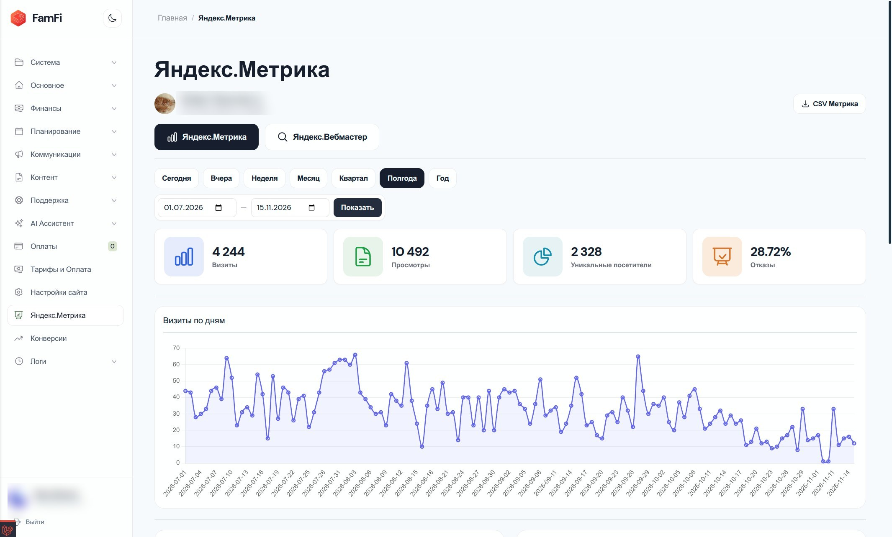

<p align="center">
  <strong>Yandex Metrika and Webmaster analytics inside MoonShine</strong><br>
  Traffic, search queries, and indexing status — in one dashboard.
</p>

<p align="center">
  <a href="README.ru.md">Русская версия</a>
</p>

<h1 align="center">MoonShine Yandex Metrika</h1>

<p align="center">
  <a href="https://packagist.org/packages/tikhomirov/moonshine-yandex-metrika"></a>
  
  
  <a href="https://github.com/tikhomirov/moonshine-yandex-metrika/actions/workflows/tests.yml"></a>
</p>

<p align="center">
  
</p>

## Features

- **Yandex Metrika:** visits, page views, unique visitors, bounce rate, daily chart, and top pages.
- **Yandex Webmaster:** indexing summary, site issues, external links, and popular search queries.
- **Flexible periods:** presets and custom date ranges.
- **CSV exports** for Metrika statistics and Webmaster queries.
- Yandex account information and API response caching.
- An extensible tab registry for adding third-party analytics without forking the package.
- Russian and English UI translations.

## Requirements

| Component | Version |
|---|---|
| PHP | 8.4+ |
| Laravel | 12 or 13 |
| MoonShine | 5.x |

## Installation

```bash
composer require tikhomirov/moonshine-yandex-metrika
php artisan vendor:publish --tag=moonshine-yandex-metrika-config
```

Register the page in your MoonShine menu and add it to the custom pages for your layout/provider:

```php
use Tikhomirov\MoonshineYandexMetrika\Pages\MetrikaDashboardPage;

MenuItem::make(MetrikaDashboardPage::class, 'Yandex Metrika');
```

## Yandex setup

Create an application at [Yandex OAuth](https://oauth.yandex.ru/), set the redirect URI to `https://oauth.yandex.ru/verification_code`, and grant the scopes you need:

| Scope | Purpose |
|---|---|
| `metrika:read` | Metrika statistics |
| `webmaster:verify` | Webmaster indexing and search queries |
| `webmaster:hostinfo` | Host details and external links |
| `login:info`, `login:email`, `login:avatar` | Yandex account email and avatar |

Add your settings to `.env`:

```dotenv
YANDEX_METRIKA_TOKEN=your_oauth_token
YANDEX_METRIKA_COUNTER_ID=your_counter_id
YANDEX_METRIKA_DEFAULT_PRESET=today
YANDEX_WEBMASTER_HOST_ID=https:example.com:443
```

`YANDEX_WEBMASTER_HOST_ID` is optional. Without it (and without a host saved on the connection page) the package loads the account's sites from the Webmaster API and picks the one matching `APP_URL` (scheme, host and port; `www` is ignored). If nothing matches, it falls back to `YANDEX_WEBMASTER_HOST_ID`, and then to the only site of the account. The auto choice is not saved. The site list is cached for 5 minutes. Metrika keeps working without a host.

### OAuth app and notices

All OAuth app details live on the **Yandex connection** page; the dashboard header shows only the account and the **Connection settings** button. If the app ClientID is not saved, the page shows the one read from login.yandex.ru/info for the current token (badge "from token"); `YANDEX_OAUTH_CLIENT_ID` overrides it.

Dashboard notices (connection errors, missing scopes, Webmaster not configured) are one short line with a **Yandex connection →** link.

When a Webmaster scope is missing, the alert offers two actions:

- **Open the app and add the scope**: opens `https://oauth.yandex.ru/client/edit/<client_id>`.
- **Reconnect Yandex**: opens the Yandex consent screen for this app and issues a new token. Yandex revokes old tokens when app scopes change. With the Client secret saved (see below), the button runs the package OAuth flow and saves the token automatically. Without it, the button opens Yandex's token page: put the new token into `YANDEX_METRIKA_TOKEN` and run `php artisan config:cache` (Yandex shows the token when the app has the redirect URI `https://oauth.yandex.ru/verification_code`).

### Yandex connection page and settings in the database

Optional. Without the migration everything works from `.env` as before.

```bash
php artisan migrate
```

The migration creates `yandex_metrika_settings`. It stores ClientID, Client secret and the token (encrypted with `APP_KEY`), the counter ID, the Webmaster host, the token scopes and the date it was obtained. A value saved in the database takes priority over env; an empty value falls back to env.

The **Yandex connection** page is registered in MoonShine automatically (disable with `'connection_page' => false`). It is not a menu item: open it with the **Connection settings** button in the dashboard header (next to CSV) or from the missing-scope alerts. The page has a **← Back to Yandex Metrika** link.

All links to Yandex (the app page, its edit page, token issuing, **Get token** / **Reconnect**) open in a new tab, so the admin stays open. After OAuth the new tab returns to the connection page and can be closed. The token date is shown in `app.timezone`.

The page shows the OAuth app (ClientID with a link to oauth.yandex.ru), where each value comes from (DB, env or auto), masked secrets, granted and missing scopes, and has the settings form, a **Get token** / **Reconnect** button and **Clear and fall back to env**.

**Webmaster host** in the form is a dropdown with the account's sites from the Webmaster API. **Auto (by APP_URL)** keeps the host unsaved and shows which site was picked. If there is no token or the API fails, the field becomes a text input and the page shows a short notice with a link to Webmaster. `yandex-metrika:connection:set --host-id=...` works as before.

**Get token** uses the OAuth authorization code flow with `state` and PKCE. It requests the scopes from `oauth_scopes` and saves the token to the database. For it to work:

1. Save ClientID and Client secret on the page (or set `YANDEX_OAUTH_CLIENT_ID` / `YANDEX_OAUTH_CLIENT_SECRET`).
2. In the app on oauth.yandex.ru add this **Redirect URI** (the package callback, shown on the page too):

   ```
   https://your-site.example/admin/yandex-analytics/oauth/callback
   ```

   `admin` is your `moonshine.prefix`. Keep `https://oauth.yandex.ru/verification_code` if you still issue tokens by hand.
3. The app must have every scope from `oauth_scopes` (by default `metrika:read`, `webmaster:verify`, `webmaster:hostinfo`), otherwise Yandex returns `invalid_scope`.

Artisan:

```bash
php artisan yandex-metrika:connection:set --client-id=... --ask-secret --counter-id=... --host-id=https:example.com:443
php artisan yandex-metrika:connection:set --ask-token   # paste a token by hand
php artisan yandex-metrika:connection:status            # values and sources, secrets masked
php artisan yandex-metrika:connection:clear --force     # delete DB settings, back to env
```

## KPI cards

The Metrika tab shows four summary cards. Their set and order are controlled by `summary_metrics` in the published config. The default is visits, page views, unique visitors, bounce rate. Unknown keys are ignored.

```php
'summary_metrics' => [
    'unique_visitors',
    'visits',
    'pageviews',
    'bounce_rate',
],
```

The `widgets` map still turns other dashboard blocks on or off. Setting a widget to `false` also hides the matching KPI card.

## Periods and exports


Available presets: today, yesterday, week, month, quarter, half year, and year, plus a custom date range. The Webmaster summary shows the site's current state; the selected period applies to search queries.

CSV export routes are available to authenticated MoonShine administrators:

- `/admin/yandex-analytics/export/metrika`
- `/admin/yandex-analytics/export/webmaster`

## AI agent skill

This package includes a ready-to-use **AI agent skill** for configuring, extending, and troubleshooting the dashboard. It is intentionally shipped in the Composer distribution at `vendor/tikhomirov/moonshine-yandex-metrika/skills/moonshine-yandex-metrika/SKILL.md`.

Install [`llm/skills`](https://github.com/roxblnfk/skills) in the host application to discover the skill from Composer dependencies and sync it into your agent's skills directory:

```bash
composer require --dev llm/skills
composer skills:init --quick
composer skills:show
```

The skill package auto-discovers `SKILL.md` files in Composer dependencies by default. Keeping this package's `skills/` directory in its distribution makes the dashboard instructions available to coding agents in the consuming application.

## Localization

The dashboard ships with **English and Russian translations** and follows the Laravel application's locale. To publish the translation files for customization:

```bash
php artisan vendor:publish --tag=moonshine-yandex-metrika-lang
```

## More information

- [Changelog](CHANGELOG.md)
- [Production checklist](https://github.com/tikhomirov/moonshine-yandex-metrika/blob/main/docs/PRODUCTION_CHECKLIST.md)
- [Dashboard skill](https://github.com/tikhomirov/moonshine-yandex-metrika/blob/main/skills/moonshine-yandex-metrika/SKILL.md)
- [Report an issue](https://github.com/tikhomirov/moonshine-yandex-metrika/issues)

## License

MIT. See [LICENSE](LICENSE).
