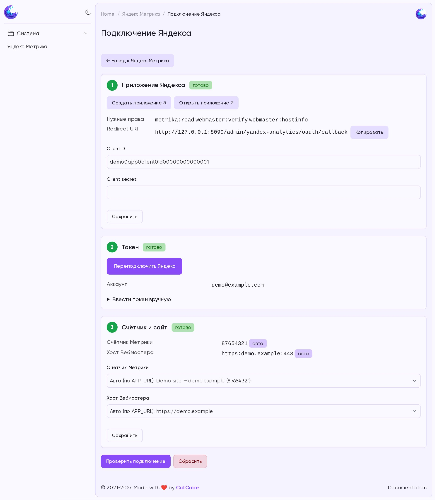

<p align="center">
  
</p>

<p align="center">
  <a href="https://packagist.org/packages/tikhomirov/moonshine-yandex-metrika"></a>
  
  
  
  <a href="https://github.com/tikhomirov/moonshine-yandex-metrika/actions/workflows/tests.yml"></a>
</p>

<p align="center">
  Yandex Metrika and Webmaster analytics inside MoonShine 5.<br>
  <a href="README.ru.md">Русская версия</a>
</p>

<p align="center">
  
</p>

## Features

- **Metrika:** visits, page views, unique visitors, bounce rate, daily chart, top pages, sources, search phrases, geo, browsers.
- **Webmaster:** indexing summary, site issues, external links, popular search queries.
- **Connection in the UI:** a 3-step page with OAuth, settings in the database with env fallback.
- **Auto setup:** the counter and the Webmaster site are picked by `APP_URL`.
- Period presets and custom ranges, CSV export, API caching, RU/EN UI, tab registry for third-party analytics.

## Requirements

| Component | Version |
|---|---|
| PHP | 8.4+ |
| Laravel | 12 or 13 |
| MoonShine | 5.x |

## Installation

```bash
composer require tikhomirov/moonshine-yandex-metrika
php artisan vendor:publish --tag=moonshine-yandex-metrika-config
php artisan migrate   # optional: settings in the database
```

Add the dashboard to the MoonShine menu:

```php
use Tikhomirov\MoonshineYandexMetrika\Pages\MetrikaDashboardPage;

MenuItem::make(MetrikaDashboardPage::class, 'Yandex Metrika');
```

The **Yandex connection** page is registered automatically and opens with the **Connection settings** button on the dashboard (disable with `'connection_page' => false`).

## Connecting Yandex

<p align="center">
  
</p>

1. **Yandex app.** Click **Create app** (oauth.yandex.ru), add the scopes below and the Redirect URI shown on the page, then save ClientID and Client secret.
2. **Token.** Click **Get token via Yandex**: OAuth authorization code flow with `state` and PKCE; the token is saved to the database. A token can also be entered by hand.
3. **Counter and site.** Pick the Metrika counter and the Webmaster site from the dropdowns, or keep **Auto (by APP_URL)**.

**Check connection** makes a fresh request to Metrika, **Reset** deletes the saved settings and falls back to env. All Yandex links open in a new tab.

**Redirect URI** (`admin` is your `moonshine.prefix`):

```
https://your-site.example/admin/yandex-analytics/oauth/callback
```

**Scopes** (`oauth_scopes` in the config; the app must have all of them, otherwise Yandex returns `invalid_scope`):

| Scope | Purpose |
|---|---|
| `metrika:read` | Metrika statistics and the counter list |
| `webmaster:verify` | Webmaster sites, indexing and search queries |
| `webmaster:hostinfo` | Host details and external links |
| `login:email`, `login:avatar` | Optional: account email and avatar in the header |

## Settings: database and env

The migration creates `yandex_metrika_settings` (ClientID, Client secret and token are encrypted with `APP_KEY`). A value saved in the database wins; an empty one falls back to env. Without the migration everything works from `.env`:

```dotenv
YANDEX_METRIKA_TOKEN=
YANDEX_METRIKA_COUNTER_ID=
YANDEX_WEBMASTER_HOST_ID=https:example.com:443
YANDEX_OAUTH_CLIENT_ID=
YANDEX_OAUTH_CLIENT_SECRET=
YANDEX_METRIKA_DEFAULT_PRESET=today
```

**Counter and Webmaster site** are chosen in this order: saved in the database → the one matching `APP_URL` (`www` is ignored; for the counter its `site` / `site2`, for the host scheme, host and port) → env → the only one in the account. The auto choice is not saved and is marked "auto". Both lists come from the Yandex APIs for the current token and are cached for 5 minutes. Without a token or on an API error the field is a text input.

Artisan:

```bash
php artisan yandex-metrika:connection:set --client-id=... --ask-secret --counter-id=... --host-id=https:example.com:443
php artisan yandex-metrika:connection:set --ask-token   # paste a token by hand
php artisan yandex-metrika:connection:status            # values and sources, secrets masked
php artisan yandex-metrika:connection:clear --force     # delete DB settings, back to env
```

## KPI cards

`summary_metrics` sets the set and order of the Metrika cards (default: visits, page views, unique visitors, bounce rate; unknown keys are ignored). A `widgets.*` flag set to `false` hides the matching block and card.

```php
'summary_metrics' => ['unique_visitors', 'visits', 'pageviews', 'bounce_rate'],
```

## Periods and exports

Presets: today, yesterday, week, month, quarter, half year, year, plus a custom range. The Webmaster summary shows the current state; the period applies to search queries.

CSV export for authenticated MoonShine admins: `/admin/yandex-analytics/export/metrika`, `/admin/yandex-analytics/export/webmaster`.

## AI agent skill

The package ships an AI agent skill at `skills/moonshine-yandex-metrika/SKILL.md` (kept in the Composer dist). With [`llm/skills`](https://github.com/roxblnfk/skills) it is picked up from Composer dependencies:

```bash
composer require --dev llm/skills
composer skills:init --quick
```

## Localization

English and Russian, by the app locale. Publish to customize:

```bash
php artisan vendor:publish --tag=moonshine-yandex-metrika-lang
```

## More information

- [Changelog](CHANGELOG.md)
- [Production checklist](https://github.com/tikhomirov/moonshine-yandex-metrika/blob/main/docs/PRODUCTION_CHECKLIST.md)
- [Report an issue](https://github.com/tikhomirov/moonshine-yandex-metrika/issues)

## License

MIT. See [LICENSE](LICENSE).
