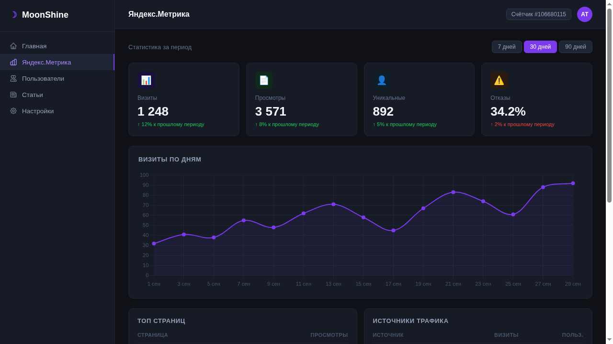

# moonshine-yandex-metrika

[](https://packagist.org/packages/tikhomirov/moonshine-yandex-metrika)
[](https://packagist.org/packages/tikhomirov/moonshine-yandex-metrika)
[](LICENSE)

Пакет добавляет в [MoonShine](https://moonshine-laravel.com) **4.x / 5.x** дашборд аналитики **Яндекс.Метрика + Вебмастер**.



## Возможности

- Вкладки **Метрика** и **Вебмастер** (реестр `AnalyticsTabRegistry` — можно добавить GA и др.)
- Компактные KPI, график визитов, топ страниц / источники / фразы / гео / браузеры
- Фильтр периода (пресеты + произвольный диапазон); на Вебмастере период влияет на **запросы**
- Summary Вебмастера: индексация, ошибки, внешние ссылки
- Блок аккаунта Яндекса (email / аватар)
- CSV-экспорт Метрики и запросов Вебмастера (только для авторизованного админа MoonShine)
- Кэш API, RU/EN локализация, точки расширения без форка пакета

> Packagist-дистрибутив: runtime (`src/`, `config/`, `resources/`, `routes/`), `composer.json`, `LICENSE`, `README.md`, `CHANGELOG.md` и **`skills/`** (playbook для AI-агентов). OAuth-скриншоты, тесты и CI остаются только в [репозитории на GitHub](https://github.com/tikhomirov/moonshine-yandex-metrika).

---

## Требования

| | |
|---|---|
| PHP | 8.2+ (для MoonShine 5 — 8.4+) |
| Laravel | 11 / 12 / 13 |
| MoonShine | 4.x или 5.x |

---

## Установка

```bash
composer require tikhomirov/moonshine-yandex-metrika
php artisan vendor:publish --tag=moonshine-yandex-metrika-config
```

`.env`:

```env
YANDEX_METRIKA_TOKEN=ваш_oauth_токен
YANDEX_METRIKA_COUNTER_ID=ваш_номер_счётчика
YANDEX_METRIKA_DEFAULT_PRESET=today
# host_id формата https:example.com:443 (см. Webmaster API hosts)
YANDEX_WEBMASTER_HOST_ID=https:example.com:443
```

Регистрация страницы в меню MoonShine:

```php
// MoonShine 4 — часто в MoonShineServiceProvider::menu()
use Tikhomirov\MoonshineYandexMetrika\Pages\MetrikaDashboardPage;

MenuItem::make('Яндекс.Метрика', MetrikaDashboardPage::class)
    ->icon('presentation-chart-bar');

// MoonShine 5 — часто в Layout:
MenuItem::make(MetrikaDashboardPage::class, 'Яндекс.Метрика');
```

Страницу также нужно добавить в `pages()` / список ресурсов провайдера MoonShine (как любую custom page).

Опционально — тонкий subclass в host-приложении:

```php
namespace App\MoonShine\Pages;

use Tikhomirov\MoonshineYandexMetrika\Pages\MetrikaDashboardPage as PackagePage;

final class MetrikaDashboardPage extends PackagePage {}
```

---

## Получение OAuth-токена

### 1. Создать приложение

1. [oauth.yandex.ru](https://oauth.yandex.ru/) → **«Зарегистрировать новое приложение»**
2. Название, иконка (можно [`docs/icon.png`](docs/icon.png) из репозитория), почта

### 2. Платформы

- Отметить **«Веб-сервисы»**
- Redirect URI: `https://oauth.yandex.ru/verification_code`

### 3. Права

| Scope | Зачем |
|---|---|
| `metrika:read` | статистика Метрики (**обязательно**) |
| `webmaster:verify` | summary / индексация / запросы |
| `webmaster:hostinfo` | внешние ссылки |
| `login:info`, `login:email`, `login:avatar` | блок аккаунта |

### 4. Токен

Открыть (под нужным аккаунтом Яндекса):

```
https://oauth.yandex.ru/authorize?response_type=token&client_id=ВАШ_CLIENT_ID
```

После **«Разрешить»** скопировать `access_token` из URL в `YANDEX_METRIKA_TOKEN`.

Номер счётчика — из URL Метрики (`?id=XXXXXXXX`) или **Настройки счётчика**.

Скриншоты шагов: [`docs/oauth-step1.jpg`](docs/oauth-step1.jpg) … [`oauth-step3.jpg`](docs/oauth-step3.jpg) (только в git-клоне).

---

## Конфигурация

Файл `config/moonshine-yandex-metrika.php` (после publish):

```php
return [
    'token' => env('YANDEX_METRIKA_TOKEN'),
    'counter_id' => env('YANDEX_METRIKA_COUNTER_ID'),
    'days' => 0, // legacy forDays(); дашборд использует default_preset
    'default_preset' => 'today',
    'cache_ttl' => 3600,
    'cache_store' => null,
    'widgets' => [
        'account' => true,
        'period_filter' => true,
        'export' => true,
        'visits' => true,
        'pageviews' => true,
        'unique_visitors' => true,
        'bounce_rate' => true,
        'top_pages' => true,
        'traffic_sources' => true,
        'search_phrases' => true,
        'geo' => true,
        'browsers' => true,
        'webmaster_summary' => true,
        'webmaster_queries' => true,
    ],
    'max_results' => 10,
    'page_title' => 'Яндекс.Метрика',
    'page_icon' => 'presentation-chart-bar',
    'webmaster' => [
        'host_id' => env('YANDEX_WEBMASTER_HOST_ID'),
        'user_id' => env('YANDEX_WEBMASTER_USER_ID'),
    ],
];
```

### Пресеты периода

| Пресет | Диапазон |
|---|---|
| Сегодня / Вчера | один день |
| Неделя | сегодня − 7 … сегодня |
| Месяц / Квартал / Полгода / Год | с начала календарного периода до сегодня |
| Произвольный | `date_from` + `date_to` |

CSV (под префиксом MoonShine, auth admin):

- `/admin/yandex-analytics/export/metrika`
- `/admin/yandex-analytics/export/webmaster`

```env
YANDEX_METRIKA_CACHE_TTL=3600
YANDEX_METRIKA_CACHE_STORE=redis
```

---

## Сервисы

```php
use Tikhomirov\MoonshineYandexMetrika\Services\MetrikaService;

public function index(MetrikaService $metrika)
{
    $visits = $metrika->totalVisits(days: 7);
    $pages = $metrika->topPages(days: 7, maxResults: 5);
}
```

| Метод | Описание |
|---|---|
| `totalVisits` / `totalPageViews` / `uniqueVisitors` / `bounceRate` | KPI |
| `topPages` / `trafficSources` / `searchPhrases` / `geoCountries` / `browsers` | таблицы |
| `visitsByDay` | ряд для графика |
| `forPeriod(DatePeriod)` | абсолютный период |
| `request(array)` | произвольный Metrika API |

Также: `WebmasterService`, `YandexAccountService`, `AnalyticsExportService`, `ConnectionProbe`.

---

## Расширение

### Вкладка из отдельного пакета (рекомендуется для GA)

Контракт `AnalyticsDashboardTab` + регистрация в `AnalyticsTabRegistry` — **без** subclass страницы в host-app.

```php
use Tikhomirov\MoonshineYandexMetrika\Contracts\AnalyticsDashboardTab;
use Tikhomirov\MoonshineYandexMetrika\Support\AnalyticsTabRegistry;
use Tikhomirov\MoonshineYandexMetrika\Support\DatePeriod;

final class GoogleAnalyticsTab implements AnalyticsDashboardTab
{
    public function id(): string { return 'google_analytics'; }
    public function label(): string { return 'Google Analytics'; }
    public function icon(): string { return 'chart-pie'; }
    public function enabled(): bool { return (bool) config('my-ga.enabled'); }
    public function usesPeriod(): bool { return true; }
    /** false — вкладка жива даже если OAuth Яндекса упал */
    public function requiresYandexConnection(): bool { return false; }

    public function render(DatePeriod $period, array $widgets, int $maxResults): array
    {
        return [/* MoonShine components */];
    }

    public function exportCsvUrl(DatePeriod $period): ?string
    {
        return null;
    }
}

// ServiceProvider::boot()
app(AnalyticsTabRegistry::class)->register(new GoogleAnalyticsTab());
```

Открытие: `?tab=google_analytics`. `ConnectionProbe` проверяет только вкладки с `requiresYandexConnection(): true`.

### Наследование страницы (BC / точечные правки)

```php
class MyMetrikaPage extends MetrikaDashboardPage
{
    protected function extraComponents(DatePeriod $period): array { /* … */ }

    protected function additionalAnalyticsTabs(): array
    {
        return [[
            'id' => 'legacy_tab',
            'label' => 'Legacy',
            'icon' => 'square-2-stack',
            'enabled' => true,
            'uses_period' => true,
            'requires_yandex' => false,
        ]];
    }

    protected function buildCustomTabContent(
        string $tab,
        DatePeriod $period,
        array $widgets,
        int $maxRes,
    ): array {
        return $tab === 'legacy_tab'
            ? [/* … */]
            : parent::buildCustomTabContent($tab, $period, $widgets, $maxRes);
    }
}
```

Хуки: `beforeComponents()`, `extraComponents()`, `buildCustomTabContent()`, `renderPeriodControlsHtml()`.

```bash
php artisan vendor:publish --tag=moonshine-yandex-metrika-views
php artisan vendor:publish --tag=moonshine-yandex-metrika-lang
```

---

## Для AI-агентов

Skill поставляется **вместе с Composer-пакетом** (и в git-клоне):

[`skills/moonshine-yandex-metrika/SKILL.md`](skills/moonshine-yandex-metrika/SKILL.md)

Путь после установки: `vendor/tikhomirov/moonshine-yandex-metrika/skills/moonshine-yandex-metrika/SKILL.md`.  
Используйте его, чтобы настроить дашборд, env, меню MoonShine, виджеты, вкладки и экспорт без чтения всего исходника.

Чеклист релиза мейнтейнера: [`docs/PRODUCTION_CHECKLIST.md`](docs/PRODUCTION_CHECKLIST.md).

---

## Локализация

Поставляется **ru** и **en**. Publish: `--tag=moonshine-yandex-metrika-lang`.

---

## Лицензия

MIT — см. [LICENSE](LICENSE).
