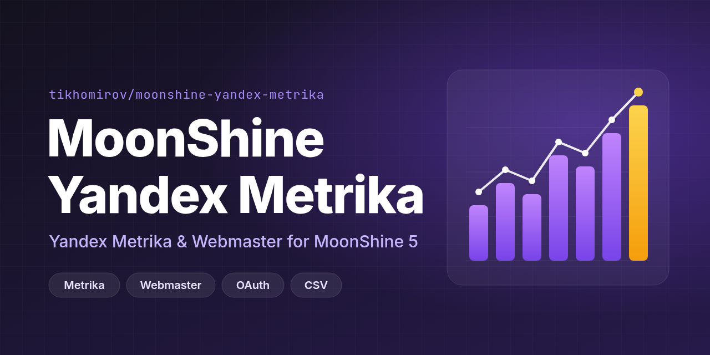
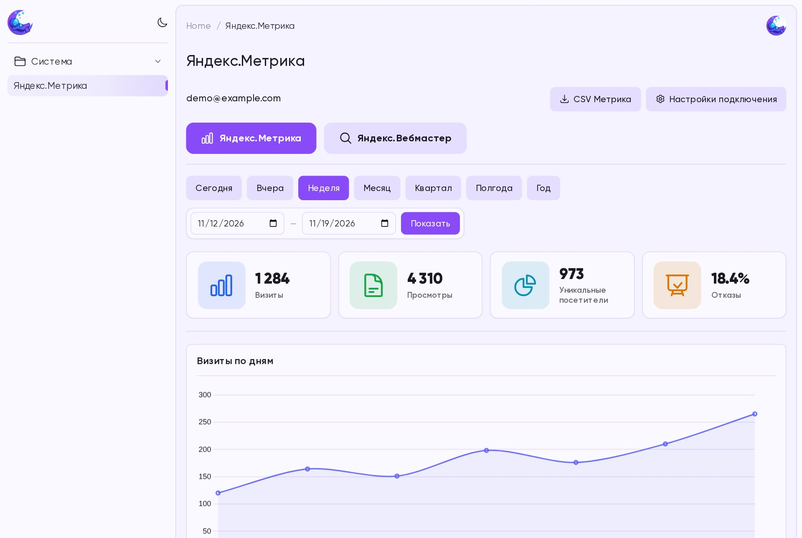
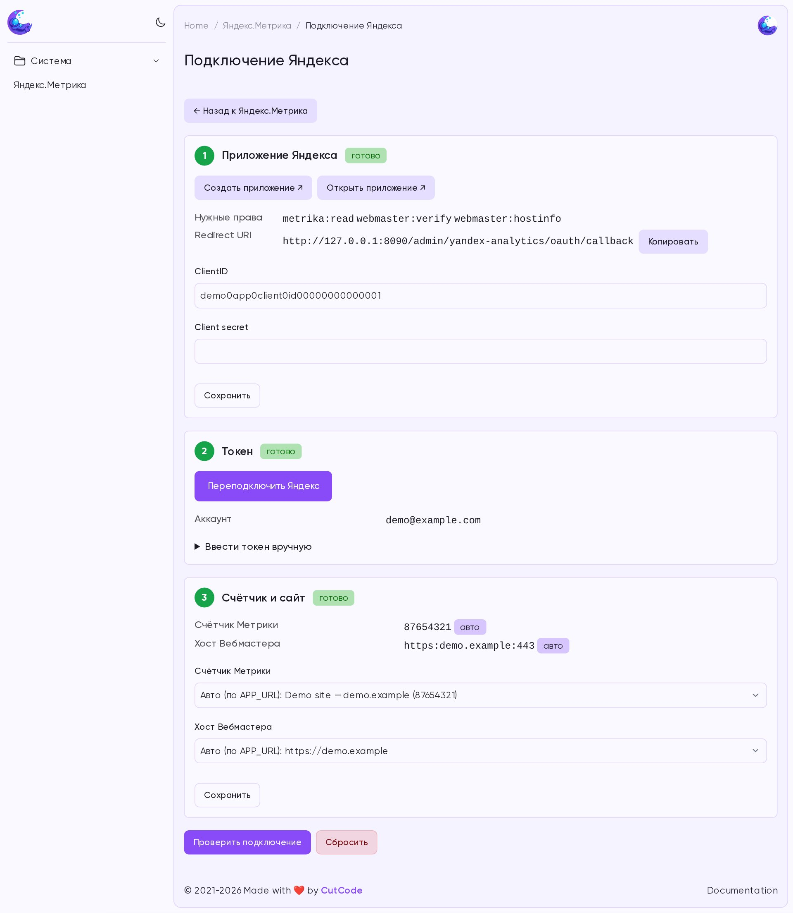

<p align="center">
  
</p>

<p align="center">
  <a href="https://packagist.org/packages/tikhomirov/moonshine-yandex-metrika"></a>
  
  
  
  <a href="https://github.com/tikhomirov/moonshine-yandex-metrika/actions/workflows/tests.yml"></a>
</p>

<p align="center">
  Аналитика Яндекс.Метрики и Вебмастера в MoonShine 5.<br>
  <a href="README.md">English version</a>
</p>

<p align="center">
  
</p>

## Возможности

- **Метрика:** визиты, просмотры, уникальные посетители, отказы, график, популярные страницы, источники, поисковые фразы, география, браузеры.
- **Вебмастер:** сводка индексации, ошибки сайта, внешние ссылки, популярные запросы.
- **Подключение в интерфейсе:** страница из трёх шагов с OAuth, настройки в БД с fallback на env.
- **Автонастройка:** счётчик и сайт Вебмастера выбираются по `APP_URL`.
- Пресеты периодов и свой диапазон, CSV-экспорт, кеш API, интерфейс RU/EN, реестр вкладок для сторонней аналитики.

## Требования

| Компонент | Версия |
|---|---|
| PHP | 8.4+ |
| Laravel | 12 или 13 |
| MoonShine | 5.x |

## Установка

```bash
composer require tikhomirov/moonshine-yandex-metrika
php artisan vendor:publish --tag=moonshine-yandex-metrika-config
php artisan migrate   # необязательно: настройки в БД
```

Добавьте дашборд в меню MoonShine:

```php
use Tikhomirov\MoonshineYandexMetrika\Pages\MetrikaDashboardPage;

MenuItem::make(MetrikaDashboardPage::class, 'Яндекс.Метрика');
```

Страница **Подключение Яндекса** регистрируется сама и открывается кнопкой **Настройки подключения** на дашборде (отключить: `'connection_page' => false`).

## Подключение Яндекса

<p align="center">
  
</p>

1. **Приложение Яндекса.** Нажмите **Создать приложение** (oauth.yandex.ru), добавьте права из таблицы ниже и Redirect URI со страницы, сохраните ClientID и Client secret.
2. **Токен.** Нажмите **Получить токен через Яндекс**: OAuth authorization code flow со `state` и PKCE, токен сохраняется в БД. Токен можно ввести и вручную.
3. **Счётчик и сайт.** Выберите счётчик Метрики и сайт Вебмастера в списках или оставьте **Авто (по APP_URL)**.

**Проверить подключение** делает свежий запрос к Метрике, **Сбросить** удаляет сохранённые настройки и возвращает env. Все ссылки на Яндекс открываются в новой вкладке.

**Redirect URI** (`admin` — ваш `moonshine.prefix`):

```
https://ваш-сайт/admin/yandex-analytics/oauth/callback
```

**Права** (`oauth_scopes` в конфиге; в приложении должны быть все, иначе Яндекс вернёт `invalid_scope`):

| Право | Для чего |
|---|---|
| `metrika:read` | Статистика Метрики и список счётчиков |
| `webmaster:verify` | Сайты Вебмастера, индексация и запросы |
| `webmaster:hostinfo` | Данные о хосте и внешние ссылки |
| `login:email`, `login:avatar` | Необязательно: почта и аватар аккаунта в шапке |

## Настройки: БД и env

Миграция создаёт таблицу `yandex_metrika_settings` (ClientID, Client secret и токен шифруются через `APP_KEY`). Значение из БД важнее, пустое берётся из env. Без миграции всё работает из `.env`:

```dotenv
YANDEX_METRIKA_TOKEN=
YANDEX_METRIKA_COUNTER_ID=
YANDEX_WEBMASTER_HOST_ID=https:example.com:443
YANDEX_OAUTH_CLIENT_ID=
YANDEX_OAUTH_CLIENT_SECRET=
YANDEX_METRIKA_DEFAULT_PRESET=today
```

**Счётчик и сайт Вебмастера** выбираются по порядку: сохранённый в БД → совпадающий с `APP_URL` (`www` не учитывается; у счётчика сравниваются `site` / `site2`, у хоста схема, хост и порт) → env → единственный в аккаунте. Автовыбор не сохраняется и помечается «авто». Оба списка берутся из API Яндекса по текущему токену и кешируются на 5 минут. Без токена или при ошибке API поле становится текстовым.

Artisan:

```bash
php artisan yandex-metrika:connection:set --client-id=... --ask-secret --counter-id=... --host-id=https:example.com:443
php artisan yandex-metrika:connection:set --ask-token   # ввести токен вручную
php artisan yandex-metrika:connection:status            # значения и источники, секреты под маской
php artisan yandex-metrika:connection:clear --force     # удалить настройки из БД, вернуться к env
```

## Карточки метрик

`summary_metrics` задаёт набор и порядок карточек Метрики (по умолчанию: визиты, просмотры, уникальные посетители, отказы; неизвестные ключи игнорируются). Флаг `widgets.*` со значением `false` скрывает блок и его карточку.

```php
'summary_metrics' => ['unique_visitors', 'visits', 'pageviews', 'bounce_rate'],
```

## Периоды и экспорт

Пресеты: сегодня, вчера, неделя, месяц, квартал, полгода, год и свой диапазон. Сводка Вебмастера показывает текущее состояние, период применяется к поисковым запросам.

CSV-экспорт для авторизованных администраторов MoonShine: `/admin/yandex-analytics/export/metrika`, `/admin/yandex-analytics/export/webmaster`.

## Skill для AI-агентов

В пакете есть skill для AI-агентов: `skills/moonshine-yandex-metrika/SKILL.md` (входит в Composer-дистрибутив). С [`llm/skills`](https://github.com/roxblnfk/skills) он подхватывается из зависимостей:

```bash
composer require --dev llm/skills
composer skills:init --quick
```

## Локализация

Русский и английский, по локали приложения. Опубликовать для правки:

```bash
php artisan vendor:publish --tag=moonshine-yandex-metrika-lang
```

## Дополнительно

- [История изменений](CHANGELOG.md)
- [Чеклист настройки и релиза](https://github.com/tikhomirov/moonshine-yandex-metrika/blob/main/docs/PRODUCTION_CHECKLIST.md)
- [Сообщить об ошибке](https://github.com/tikhomirov/moonshine-yandex-metrika/issues)

## Лицензия

MIT. Подробности — в [LICENSE](LICENSE).
